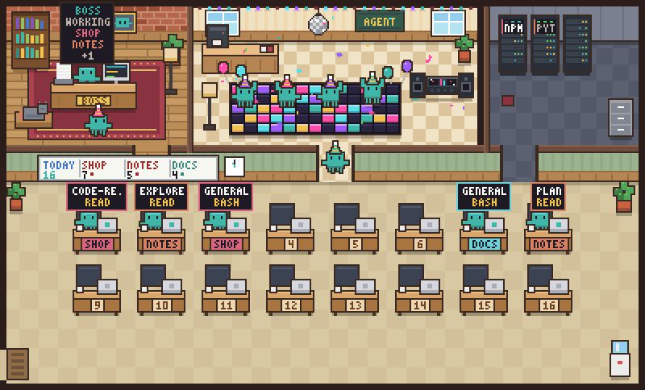

# Agent Office

**A pixel-art office for Claude Code.** Run Claude Code in several projects at once and watch every subagent walk into one shared office, sit at a desk with its current tool, and carry its result to the boss when it is done.



Agent Office is a macOS and Linux app, new on Windows (and a Claude Code plugin that powers it). It wraps the real `claude` CLI: nothing is re-implemented, your settings, MCP servers and permissions work as usual.

## Features

- **A terminal per project.** Add your project folders in the sidebar; each one gets its own `claude` session that keeps running in the background while you look at another.
- **One boss over every project.** All projects' agents share the office. Desks carry a colored project tag, the whiteboard counts today's deliveries per project, and the boss's sign shows which projects keep it busy.
- **See what an agent is doing.** Click any worker to open a live panel: its task, the command or file it is on right now (`Bash: npm test`, `Edit: src/app.ts`), its last 20 tool calls and, once done, its result. Click the boss for a summary of every project.
- **Several Claude accounts.** Add accounts in the sidebar, log in with one click, and pick which account each project uses. Each account has its own Claude Code config folder, so logins never mix.
- **Knows when Claude needs you.** A project waiting for your approval, or one that just finished (its background agents too) while you were looking elsewhere, raises a desktop notification, shows on the Dock badge (macOS; a dot on the taskbar button on Windows) and gets a mark on its row; the boss's sign says NEEDS YOU (and WAITING ON AGENTS while its turn is over but its agents still work). Click the notification to jump there.
- **Plan usage per account.** Under each account, the 5-hour and weekly usage of its Claude plan (Pro/Max) and when each one resets, taken from that account's last Claude session, with a notification at 80% and 95%.
- **Antigravity per project.** A project can run Google Antigravity CLI (`agy`) in its terminals instead of Claude Code, for Google accounts that can no longer use Gemini CLI. See [Antigravity projects](#antigravity-projects).
- **Command Code per project.** A project can run Command Code (`commandcode`, its own login) instead of Claude Code. The office follows it one way, from its terminal and its own session logs (read only): the boss works, asks, delivers and sleeps, and today's token cost is shown. Nothing of the office or Claude Code is passed to it. See [Command Code projects](#command-code-projects).
- **OpenCode per project, with or without a login.** A project can run OpenCode (`opencode`) instead of Claude Code. It needs no login: its free models work out of the box, and you can sign in from the Accounts section whenever you like. The office follows it one way, from its terminal. See [OpenCode projects](#opencode-projects).
- **Move a session to another computer.** Save a project's idle Claude session, its code changes and its memory in one `.agentoffice` file; open it on another Mac, Linux or Windows computer and the conversation continues there.
- **Local only.** No server, no telemetry. Everything stays on your computer.

> The app and the plugin speak English and Turkish. The app follows your system language; pick one with **Language** at the bottom of the sidebar. Other translations are welcome (see [Contributing](#contributing)).

## Install

Requirements: macOS 12 or newer, 64-bit Linux (x64) with a desktop, or 64-bit Windows 10 (1809) or newer, and [Claude Code](https://code.claude.com) installed and on your `PATH` (on macOS and Linux your login shell's `PATH`: the app starts `claude` through `$SHELL -l -i`, by default zsh on macOS and bash on Linux; on Windows see [below](#windows-new-experimental)).

### Homebrew

```sh
brew install --cask isisever/tap/agent-office
```

The app updates itself; remove everything, including app data, with `brew uninstall --zap --cask agent-office`.

### Download

Get the `.dmg` for your Mac from [Releases](https://github.com/isisever/agent-office/releases/latest):

| Mac | File |
| --- | --- |
| Apple Silicon (M1 and later) | `AgentOffice-<version>-arm64.dmg` |
| Intel | `AgentOffice-<version>-x64.dmg` |

Open it and drag **Agent Office** to Applications.

### Linux

Get the Linux package from [Releases](https://github.com/isisever/agent-office/releases/latest) (x64):

| Package | File | |
| --- | --- | --- |
| AppImage (any distribution) | `AgentOffice-<version>-x86_64.AppImage` | `chmod +x` it and run it; it updates itself |
| Debian, Ubuntu | `AgentOffice-<version>-amd64.deb` | `sudo apt install ./AgentOffice-<version>-amd64.deb`; update by installing the next `.deb` |

On Linux the window has the normal title bar, and the shortcuts use **Ctrl+Shift** instead of ⌘ (Ctrl+V, Ctrl+O and the like go to Claude Code in the terminal): **Ctrl+Shift+V** pastes, **Ctrl+Shift+C** copies, **Ctrl+Shift+O** adds a project, **Ctrl+Shift+1 … 9** switches. Pasting files copied in a file manager works best with `wl-clipboard` (Wayland) or `xclip` (X11) installed. If the AppImage does not start on Ubuntu 24.04 or newer (a sandbox error), use the `.deb`, which installs the AppArmor profile Electron needs.

### Windows (new, experimental)

Windows support is new and has seen little real use yet; please [report](https://github.com/isisever/agent-office/issues) what breaks. Get the installer from [Releases](https://github.com/isisever/agent-office/releases/latest) (x64):

| Package | File | |
| --- | --- | --- |
| Installer | `AgentOffice-<version>-Setup.exe` | Run it; it installs for your user only (no administrator rights) and updates itself |

The app is not code-signed, so Windows SmartScreen stops the installer with **Windows protected your PC**: click **More info**, then **Run anyway**. Your browser may also ask whether to keep the download.

It needs [Claude Code for Windows](https://code.claude.com/docs/en/setup) (the native install, with [Git for Windows](https://git-scm.com/downloads/win), which Claude Code uses), and `claude` must run in a new terminal: the app starts `claude` directly (no shell) from your `PATH` or from the native installer's `%USERPROFILE%\.local\bin`; an npm install (`claude.cmd`) works too. If it cannot find Claude Code, the terminal says so; install it and press Enter there.

On Windows the window has the normal title bar and menu, and the shortcuts are the Linux ones: **Ctrl+Shift+V** pastes (images too: the app hands them to Claude Code with its Alt+V), **Ctrl+Shift+C** copies, **Ctrl+Shift+O** adds a project, **Ctrl+Shift+1 … 9** switches. Files copied in Explorer paste as quoted paths. A project waiting for you puts a dot on the taskbar button and flashes it.

### Updates

Agent Office checks GitHub Releases shortly after it starts, then every hour, and when you come back to its window after half an hour or more (on Linux only the AppImage does; the `.deb` is updated by installing the new one; on Windows the installed app does). A new version downloads in the background; then **⬆ … ready · restart** appears in the title bar (or it installs when you quit). You can also check from the app menu: **Check for Updates…**. The running version is in **About Agent Office** and in the tooltip of the title bar's AGENT OFFICE.

Homebrew keeps showing the version it installed, because the app updates itself: `brew outdated` may list an old version although the app is current. That is harmless; `brew upgrade --greedy agent-office` makes Homebrew reinstall the latest one.

## Using it

| | |
| --- | --- |
| **Add a project** | **+ Add project** in the sidebar, or ⌘O (Linux, Windows: Ctrl+Shift+O) |
| **Switch projects** | Click a project, or ⌘1 … ⌘9 (Linux, Windows: Ctrl+Shift+1 … 9) |
| **Run several Claudes in a project** | Hover the terminal and click **+** (or ⌘T; Linux, Windows: Ctrl+Shift+T): pick the same folder or, in a git repository, a new git worktree (⇧⌘T on macOS). A worktree goes next to the repository as `<repo>-wt-<n>` on a new branch `agent-office/<n>`. Tabs appear above the terminal (⇧⌘[ / ⇧⌘] switch tabs). Closing a worktree tab asks whether to remove the worktree; git refuses if it has changes, and the branch is kept. The office counts a worktree's agents under its project. |
| **Choose a project's account** | The **Account ▾** picker on the project's row. Its last entry, **+ New account…**, creates an account for that project. |
| **Log in to an account** | **Log in** next to the account. A small terminal runs `claude auth login`; approve in the browser and it closes by itself. |
| **See an account's usage** | The **5 h** and **Week** bars under the account: percentage used and reset time. They fill in once a project on that account has talked to Claude; hover for how old the value is. |
| **See what a project costs** | Each project row shows **≈ $… today · N%**: today's tokens priced at API list prices (an estimate, not a bill) and what share of the full price that is, since most tokens are cheap cache reads. Click it for the details: total tokens, output, input, cache writes and cache reads with their shares of tokens and of cost, the main session against its sub-agents, each model, and the last 24 hours hour by hour; switch between today, 7 days and since the project was added. Read from Claude Code's own transcripts of the project's folder, its tabs and its worktrees, on the project's account. |
| **See what an agent does** | Click the worker in the office. Esc closes the panel. |
| **Pick up where you left off** | **Continue last session** at the bottom of the sidebar (on by default): when the app starts, each project continues its last Claude session (`claude --continue`) |
| **Carry on after a restart** | **Resume interrupted work on launch**, under it (on by default): if the app closed while Claude was working (an update, a restart, a crash, a reboot), that project starts right away when the app opens again and Claude is told to check what was finished and continue the unfinished work, restarting sub-agents that were cut off |
| **Resume unfinished work by hand** | **↻ Resume unfinished work** under **+ Add project** (or **File → Resume Unfinished Work**): checks every project and tab, and each Claude whose last turn never finished (its conversation ends on a prompt, a tool call or a tool result rather than Claude's answer; a turn you stopped yourself does not count) is told to check what was finished and carry on. A stopped or sleeping one starts with its session; an idle one gets the message typed in and sent. Busy ones and ones with unsent text in the prompt are left alone. A note under the button names the projects. Catches what the automatic resume misses, e.g. after updating from an older version |
| **Use one project from another** | Every project's Claude knows the other projects in the office (name, folder, account and MCP servers), so "do X in the shop-api project" means that folder, not a search of the disk. With **Share MCP servers between projects** at the bottom of the sidebar (on by default) it also gets the MCP servers the other projects have set up (their local servers and the approved ones in their `.mcp.json`, **tokens included**), whichever account they run on: a server it already has is not added twice, and one whose name it already uses for another setup gets the project's name added (`onprem-shop-api`). Applies to Claude sessions started afterwards; an account that does not use Default's MCP servers gets none of these either. |
| **Know what the other projects' bosses did** | Every Claude in the app notes each turn that did something in an office journal: the folders it worked in, the new git commits there, your prompt, a short summary and where its transcript is. When you next write to another project's Claude, it is told about the entries that concern its project (work in its folder or a worktree of it, or turns that name it), each once, so a commit made for project B from project A's terminal is news to B's boss. Ask "what did the other session do?" and it reads the journal and those transcripts. Secrets such as tokens and keys are removed from what is stored. |
| **Load a new MCP server** | After `claude mcp add` (or an edited `.mcp.json`, an approval, a project added), Claude Code needs a restart to see it. With **Reload sessions when MCP changes** at the bottom of the sidebar (on by default), each running Claude whose MCP servers changed restarts by itself in the same conversation as soon as it is idle (never while it works, runs agents or background shells, waits for an approval or has unsent text in its prompt); a dim line in its terminal says so. Typing `/exit` and pressing Enter also restarts Claude in the same conversation. |
| **Let the boss delegate** | **Manager mode — delegate to agents** at the bottom of the sidebar (on by default; see [The boss delegates](#the-boss-delegates)) |
| **Delegate in one project, not another** | **Boss** in the project row: **Global** follows Manager mode, **Delegates** or **Does it itself** overrides it for that project. Idle tabs restart with their session right away; busy ones switch at their next start. In both modes the boss keeps going instead of stopping on a list of next steps (see [The boss delegates](#the-boss-delegates)). |
| **Pick the model the agents run on** | **Agent model** in the project row: **Auto** (default) lets the boss choose per agent: Haiku for searches and lookups, Sonnet for routine edits, tests and builds, its own model for design, hard debugging and reviews. **Sonnet**, **Haiku** or **Opus** runs every agent of that project on that model (Claude Code's `CLAUDE_CODE_SUBAGENT_MODEL` with `_FORCE`). The boss's own model is unchanged. Idle tabs restart with their session right away; busy ones switch at their next start. |
| **Make long conversations cheaper** | **Context cap** in the project row: **Auto** (default) lets Claude Code decide when to summarize the conversation (on a 1M model, not before it is close to 1M tokens). **200K** or **400K** makes the boss and its agents summarize once their conversation nears that size (Claude Code's `CLAUDE_CODE_AUTO_COMPACT_WINDOW`), so each step re-reads less and costs less; details of earlier work are then kept only as a summary. Idle tabs restart with their session right away; busy ones switch at their next start. |
| **Save memory** | **Sleep idle sessions** at the bottom of the sidebar (default: after 30 min). Each Claude holds its whole conversation in memory (about 70 MB fresh, 250–350 MB after a long session), so the app starts a project's Claude only when you first open the project, and ends a background project's Claude once it has been idle that long. Opening the project again continues the same session (`claude --resume`); a hollow dot marks a sleeping project. A session never sleeps while it works, waits for approval, runs agents, background shells or scheduled tasks (`/loop`, cron), has a typed but unsent prompt, or is the project you are looking at. **Off** starts every Claude at launch and keeps it running, as before. |
| **Run Antigravity instead of Claude Code** | **Engine** in the project row: **Claude Code** (default), **Antigravity**, **Command Code** or **OpenCode**. Changing it starts every tab of the project again, fresh. See [Antigravity projects](#antigravity-projects), [Command Code projects](#command-code-projects) and [OpenCode projects](#opencode-projects). |
| **Move a session to another computer** | Right-click the project → **Move Session to Another Computer…** saves an `.agentoffice` file; double-click it on the other computer (or **File → Open Session File…**). See [Move a session to another computer](#move-a-session-to-another-computer). |
| **See what got done today** | Click the whiteboard: every delivery of the day with its project, duration, tool count and whether it succeeded |
| **Today's summary in the terminal** | `/office stats` (Turkish: `/office istatistik`) in any project's Claude: today's deliveries, agent time, working agents and background shells as text |
| **Change the language** | **Language** at the bottom of the sidebar: Auto (system language), English or Türkçe. The labels here are the English ones. |
| **Change the office theme** | **Theme** at the bottom of the sidebar: **Auto (per project)** gives each project its own colors (or the theme from your `themes.json` whose `match` fits it); classic, forest or one of the eight [gallery themes](plugin/README.md#theme-gallery) colors the whole office and the window frame. Hover an entry for its description. Your **Bot color** still wins over a theme's bots. |
| **Change the bots' color** | **Bot color** at the bottom of the sidebar (↺ resets it) |
| **Hide the sidebar** | ≡ in the title bar |

The **Default** account is your normal Claude Code login in `~/.claude`. Every other account uses what you installed there too: your plugins, personal skills, agents, commands, output styles, `CLAUDE.md` and user MCP servers, **including the tokens in their headers or environment**, so a project gets the same tools whichever account it runs on. Each account keeps its own login, `settings.json`, history and the skills claude.ai syncs for that account; an MCP server, plugin or skill the account has set up itself wins over Default's one of the same name. To keep an account apart, untick **Use Default's plugins, skills and MCP servers** under it in the sidebar; it applies when that account's Claude sessions start next. Project memory is shared as well: every account reads and writes the project's memory in `~/.claude/projects/…/memory/`, the same one plain Claude Code uses, so your saved rules apply whichever account a project runs on.

## The boss delegates

Each project's Claude is the boss of its office. With **Manager mode — delegate to agents** on (the default), every Claude session the app starts gets a short extra section in its system prompt that tells it to act as a manager, a dispatcher who stays available to you:

- delegate by default: anything that takes real work (investigating code, editing files, builds, tests, long commands, batches of MCP calls) goes to subagents running in the background, independent pieces to separate agents in parallel (in separate git worktrees when they would touch the same files); its own tool use is kept to quick orientation, reviewing what agents report, integrating their work and the final check, and only trivial requests (an answer it knows, one quick command) it does itself;
- give each agent one scoped task and start a fresh agent for the next one rather than piling work onto a finished agent (a continued agent re-reads its whole, growing context on every request);
- pick each agent's model: Haiku for searches, Sonnet for mechanical edits, test and build runs and routine fixes, its own model for design, hard debugging and reviews (or the project's **Agent model**, when set);
- while agents work, answer you and take new requests instead of making you wait;
- for a job that belongs to another project, work in that project's folder with absolute paths (and have its agents do the same), so the sidebar and the office show the work under that project (see [Work across projects](#work-across-projects));
- keep going until the task list is done instead of ending with a "remaining / next steps" list of work it could do now;
- stop only for what needs you: approving outward-facing or destructive actions (production deploys, publishing, deleting data, spending money), credentials or logins, and decisions that are yours, asked together in one short list once everything else is done;
- report honestly what it verified.

Your own instructions (`CLAUDE.md`, what you ask for) come first. Being part of the system prompt, the section stays through `--continue`, `/resume`, `/clear` and compaction; subagents don't get it.

If the boss still makes six tool calls of its own in a row within one turn without handing anything off, the plugin adds a one-line reminder after that call's result (hand the rest to background agents and stay available; carry on if you asked it to do the work itself). It comes at most once per turn and never for subagents; starting an agent resets the count.

When the boss is about to stop, the plugin reads its last message. If it ends on a list of remaining work, next steps or an offer ("want me to…?", "istersen … yapayım") that it could do itself, the stop is blocked and Claude is told to do that work now (through agents in manager mode), stopping only when the list is done or it needs you for an approval, a login or a decision of yours. A quick check of the wording (Turkish and English) finds the candidates and Claude's small fast model confirms them; it never blocks more than twice per message you send, while agents or background jobs are still running, or after an error or an interrupt, and not when you asked for a list of next steps or suggestions yourself. This guard is on in every app project, also in **Does it itself** mode.

To turn it off, untick **Manager mode** in the sidebar, or set **Boss** in a project row to **Does it itself** for that project only. The change applies to Claude sessions started afterwards (a new tab, a restart, the next launch); running ones keep what they started with. Plain Claude Code with the plugin gets it only when you set `AGENT_OFFICE_MANAGER=1` yourself.

## Work across projects

You can give one project's Claude a job that belongs to another project in your list. The plugin notes the folder each agent and the boss work in (from the files they read and edit, the paths they search and a leading `cd` in their commands), and the app places that folder under the project that holds it (the deepest one when projects nest; worktree tabs count as their project). That project then shows as working in the sidebar, for example **2 working · worked on from shop**, its agents sit at its desks in the office, and an agent's panel says where it is worked on from. Approvals and the "done" notification stay with the project whose terminal runs the session, since that is where you answer them, and the title bar counts every agent once.

## Move a session to another computer

Stop on one computer, carry on on another: the conversation, the uncommitted code and the project memory go in one file.

**Save.** Right-click the project in the sidebar (or **File → Move Session to Another Computer…** for the project you are looking at). It works only while the session is idle: no turn running, no permission prompt open, no agent or background shell running, no unsent text in the prompt; otherwise it says what to wait for. You see what goes in and save `<project>-<date>.agentoffice`.

**Open.** On the other computer, double-click the file (or **File → Open Session File…**). Agent Office shows where it comes from (machine, system, date, branch and commit), suggests the project in your sidebar with the same git remote or name (or asks for the folder; an empty folder can be cloned into), checks out the code, puts the session in place and opens it in the project's terminal with `claude --resume`.

What the file holds:

| Part | What |
| --- | --- |
| Conversation | The session's transcript and what Claude Code keeps next to it (subagent transcripts, saved tool outputs). Folder paths in it are rewritten from the old project folder to the new one, also between macOS, Linux and Windows. |
| Code | Uncommitted changes and new files (your `.gitignore` applies) as one git commit object on top of your `HEAD`, plus every commit that is not on a remote, in a git bundle; the same changes as a readable `changes.patch`. Your branches, index and stash are not touched, and nothing is pushed. |
| Memory | The project's Claude Code memory (`MEMORY.md` and its files). On import it is merged: files that already exist there win. |
| Office | The office's session file (today's deliveries). |
| Description | App and Claude Code versions, source system and machine name, project path, account name, session id, branch, commit and remote URLs (without passwords or tokens). |

Never in it: your Claude login (`.credentials.json`, the keychain, `.claude.json`), settings files, and untracked files that look like secrets (`.env`, private keys, `.netrc`…; the save dialog lists what it left out). The file does contain the conversation, the tool outputs in it (file contents, command output) and your code: keep it to yourself.

On import:

- The folder must be a clone of the same repository (a different remote asks first) with no uncommitted changes to tracked files: commit or stash them first, nothing is changed until then.
- If the folder is at the session's commit, the changes are laid on top as uncommitted changes. If it is on another commit, Agent Office offers a new branch at the session's commit (the session's branch name if it is free here, else `agent-office/handoff-<id>`); your current branch stays as it is.
- Missing commits come from the file's bundle; commits that are on the remote are fetched (fetch only).
- A session id that already exists on this computer is never overwritten: you can import it as a new session beside it.
- If Claude Code cannot open the imported session (an older Claude Code, for instance), the app says so and keeps the files; it does not quietly start a fresh session.
- Project folders whose path is longer than 200 characters get no memory (Claude Code names their folders with a hash Agent Office cannot reproduce); the conversation cannot be imported into such a folder.

## Antigravity projects

Google stopped serving Gemini CLI to Google AI Pro and free individual accounts and points them to Antigravity. A project can run Google Antigravity CLI (`agy`) instead of Claude Code: set **Engine** in its row to **Antigravity**. Every tab of the project starts again with `agy` in the project's folder (a worktree tab in its worktree); with **Continue last session** on, it continues the last conversation agy had in that folder (`agy --continue`, which agy keeps per folder). Switching back to **Claude Code** starts the tabs fresh too, since the two share no conversation.

It needs `agy` installed and on your `PATH` (on macOS and Linux your login shell's, as for `claude`; on Windows `agy` must run in a new terminal, else the terminal says so and Enter tries again), and logged in: agy keeps its own Google login and data in `~/.gemini/antigravity-cli`, so log in inside its terminal the first time. Agent Office passes it none of Claude Code's setup and nothing of the office: its environment holds only what a terminal program needs (`PATH`, `HOME`, user, shell, locale, temp folder; the usual system variables on Windows) and your own `GEMINI_*` / `GOOGLE_*` variables, never `ANTHROPIC_*`, `CLAUDE_*`, `AGENT_OFFICE_*` or MCP tokens. Changing the engine while Claude is working is refused, and leaving Antigravity while it runs asks first.

What applies to Claude Code only, for now: the account, **Boss**, **Agent model**, **Context cap**, **Savings** and **Backup** pickers (hidden in an Antigravity row), plan usage and the token cost, the plugin and status line, shared memory and MCP servers, the MCP reload, resuming interrupted work, sleeping idle sessions and moving a session to another computer. The office shows no workers for an Antigravity project yet; its animations will come through agy's hooks later.

## Command Code projects

A project can also run Command Code instead of Claude Code: set **Engine** in its row to **Command Code**. Every tab of the project starts again with `commandcode` (the same binary on macOS, Linux and Windows; not `cmd`, which is Windows' own shell) in the project's folder (a worktree tab in its worktree); with **Continue last session** on, it continues its last session in the folder (`--continue`, kept in `~/.commandcode/projects`).

It needs Command Code installed (`npm i -g command-code`; `commandcode` must run in a new terminal) and logged in inside a Command Code terminal. Like Antigravity it gets nothing of Agent Office or Claude Code: its environment is an allowlist (no Claude, Anthropic, office or MCP variables), and no brief, project list, plugin or mod is passed to it. The office follows it from its terminal and its own session logs (read only): the boss works, asks for approval, each finished turn counts as a delivery, idle tabs sleep, and the **≈ $… today** cost is read from Command Code's own `costUsd`. The account, **Boss**, **Agent model**, **Context cap**, **Savings** and **Backup** pickers are hidden; no workers are shown.

## OpenCode projects

A project can also run OpenCode instead of Claude Code: set **Engine** in its row to **OpenCode**. Every tab of the project starts again with `opencode` in the project's folder (a worktree tab in its worktree); with **Continue last session** on, it continues its last session in the folder (`--continue`; a folder with none just starts a new one).

**No login needed.** OpenCode's free models (the `opencode/` provider) work without any account, and it picks one itself; the **OpenCode** row in Accounts then reads *No login · free models*. To use your own models, press **Log in** on that row. On OpenCode 1.x it asks how: **Normal login** runs `opencode console login` in a terminal window (open the link it shows and enter the device code), **Provider or API key** runs `opencode auth login` (it asks which provider; a browser opens or you paste an API key). On OpenCode 2.x there is one way: it runs `opencode auth login opencode`. **Log out** runs `opencode console logout` (2.x: `opencode auth logout opencode`); when you are not signed in to the OpenCode Console but to another provider, it runs `opencode auth logout`, which asks which one. The row lists the integrations you are logged in to; the app asks OpenCode itself (`opencode auth list --format json`) and reads only their identity and method, never the keys. **Add account → OpenCode** shows the row (it also appears by itself when `opencode` is installed).

It needs OpenCode installed (`curl -fsSL https://opencode.ai/install | bash`, or `npm i -g opencode-ai`; `opencode` must run in a new terminal). Like Antigravity it gets nothing of Agent Office or Claude Code: its environment is an allowlist (no Claude, Anthropic, office or MCP variables; your own `OPENCODE_*` settings and provider API keys such as `OPENAI_API_KEY` do pass), and no brief, project list or plugin is passed to it. The office follows it from its terminal only (OpenCode keeps its sessions in a database, which is not read): the boss works, asks for approval, each finished turn counts as a delivery and idle tabs sleep. No token cost or workers are shown, and the account, **Boss**, **Agent model**, **Context cap**, **Savings** and **Backup** pickers are hidden.

## How it works

```
 ┌──────────── Agent Office.app ─────────────┐
 │  sidebar   office (canvas)   agent panel  │
 │  terminal: claude ── one per project      │◄── reads ~/.claude/agent-office/sessions/*.json
 └──────────────────┬────────────────────────┘
                    │ starts claude --plugin-dir <bundled plugin>
                    ▼
        Claude Code + agent-office plugin ──► writes agents, tools, deliveries
```

1. The app starts `claude` for each project in a pseudo-terminal, with the bundled plugin and, for non-default accounts, `CLAUDE_CONFIG_DIR` pointing at that account's folder.
2. The plugin ([`plugin/`](plugin)) listens to Claude Code's hook events: subagents starting, calling tools and finishing. It writes a small state file per session. In manager mode it also adds the [manager section](#the-boss-delegates) to the system prompt.
3. The app reads those files twice a second and draws the office.

## Privacy

All data stays on your machine:

| Where | What |
| --- | --- |
| `~/.claude/agent-office/sessions/` | Per session: the agents, the first 600 characters of each agent's task and 4000 of its result, and a one-line summary of its last 20 tool calls (commands, file paths, search patterns, URLs), and the folder each agent and the boss last worked in. Removed automatically a day after the session ends. |
| `~/.claude/agent-office/journal.jsonl` | One line per Claude turn that did something: time, project, account name, the folders it worked in, its new git commits (hash, subject, branch), your prompt's first 150 characters, the first 400 of Claude's answer (code left out, obvious tokens and keys removed) and the transcript's path. Capped at 2 MB, then moved to `journal.1.jsonl`. |
| `.agentoffice` files | Only where you save them: a session you chose to move (see [Move a session to another computer](#move-a-session-to-another-computer)). |
| `~/Library/Application Support/Agent Office/` (Linux: `~/.config/Agent Office/`, Windows: `%APPDATA%\Agent Office\`) | Your project list, the config folders of the accounts you added (each one holds that account's Claude Code login, plus links to your `~/.claude` skills, agents, commands, output styles and `CLAUDE.md`), under `mcp/` each open tab's copy of the MCP servers it borrows (your user MCP servers for other accounts, the other projects' servers; readable only by you), under `directory/` each open tab's list of the office's projects (names, folders, accounts, MCP server names), under `shared-plugins/` a small manifest for plugins whose manifest lives in their marketplace, and, under `usage/`, each project's latest Claude Code status line input (model, context and plan usage), used for the usage bars. |

Nothing is sent anywhere by Agent Office. Claude Code itself talks to Anthropic as usual.

## The plugin on its own

Without the app, the plugin draws the office right in your terminal (`/office`, best in Ghostty, kitty or WezTerm):

```
/plugin marketplace add isisever/agent-office
/plugin install agent-office@agent-office
```

See [plugin/README.md](plugin/README.md).

## Building from source

```sh
git clone https://github.com/isisever/agent-office
cd agent-office/app
npm install
npm start            # run the app from source
npm run dist         # build release/*.dmg and *.zip for arm64 and x64
npm run dist:linux   # on Linux: build release/*.AppImage and *.deb for x64
npm run dist:win     # build release/AgentOffice-<version>-Setup.exe (NSIS, x64, unsigned)
```

On Linux, `npm install` compiles node-pty from source (it has no prebuilt Linux binary), so it needs `python3`, `make` and a C++ compiler (`sudo apt install build-essential python3` on Debian/Ubuntu). Build the Linux packages on Linux: a macOS build would carry the macOS node-pty. The Windows installer can be built on any of the three: node-pty ships its Windows prebuild (ConPTY), which only the Windows build packs (`scripts/win-builder-config.cjs`).

Tests:

```sh
node --test app/test/main.test.cjs        # main process: projects, accounts
node app/test/office.test.mjs             # office renderer and session reading
claude plugin test plugin                 # plugin hooks
node plugin/tests/viewer-smoke.mjs        # terminal viewer
```

`app/renderer/index.html` also opens in a plain browser with a fake backend (`renderer/dev-mock.js`), handy for UI work: serve `app/` with any static server and open `/renderer/index.html`.

The demo GIF above is drawn by the office renderer itself: `node app/scripts/make-demo.mjs` rewrites `plugin/docs/demo.gif` (needs `ffmpeg`).

### Releasing

Write the release notes to a file, then from a clean `main` whose CI run passed:

```sh
node scripts/release.mjs 0.6.0 --notes notes.md --dry-run   # print every step, change nothing
node scripts/release.mjs 0.6.0 --notes notes.md
```

It sets the version in `app/package.json`, `app/package-lock.json` and `plugin/.claude-plugin/plugin.json` and commits "Version 0.6.0"; runs `npm run dist:release` in `app/`; checks that each dmg's app is notarized (`spctl`); pushes and creates the GitHub release `v0.6.0` with the dmgs, zips, blockmaps and `latest-mac.yml` (what the in-app updater downloads); writes and commits the Homebrew cask and copies it to the [tap](https://github.com/isisever/homebrew-tap). Publishing the release starts the `release-linux` workflow, which builds the AppImage and `.deb` on Linux and adds them, with `latest-linux.yml`, to the same release, and the `release-windows` workflow, which adds the Windows installer, its blockmap and `latest.yml` (run either by hand from the Actions tab with the tag if needed).

`npm run dist:release` signs with the maintainer's Developer ID and notarizes with Apple. It needs that certificate in the keychain and a notarytool profile stored once with `xcrun notarytool store-credentials agent-office --apple-id <apple id> --team-id <team id>` (override the names with `CSC_NAME` and `APPLE_KEYCHAIN_PROFILE`). Without them, `npm run dist` builds an ad-hoc-signed copy for local use.

By hand, if the script stops halfway:

1. Bump `version` in `app/package.json`, `app/package-lock.json` and `plugin/.claude-plugin/plugin.json`; commit and push.
2. `cd app && npm run dist:release`
3. `gh release create v<version> --notes-file notes.md app/release/AgentOffice-<version>-* app/release/latest-mac.yml`
4. `node packaging/homebrew/update-cask.mjs`, commit `packaging/homebrew/Casks/agent-office.rb` and copy it to the tap.

## Contributing

Issues and pull requests are welcome; [CONTRIBUTING.md](CONTRIBUTING.md) explains the layout, the tests and the conventions. Some good places to start:

- More translations of the app interface (one file per language in `app/locales/`, see CONTRIBUTING.md)
- Windows: the port is new, so testing and fixes on real machines are very welcome; Linux and Windows arm64

The app's main process, UI and office renderer meet at the interfaces described in [`app/CONTRACT.md`](app/CONTRACT.md); please keep it up to date when you change them.

## License

[MIT](LICENSE)

Agent Office is an independent project. It is not affiliated with, endorsed by or sponsored by Anthropic. Claude and Claude Code are trademarks of Anthropic, PBC.
